# Appship

Appship 是一款面向 iOS 开发者的命令行自动化工具，旨在简化应用从构建、打包到内测分发的完整流程。

它支持自动构建和导出 IPA，并将应用上传至蒲公英（Pgyer）或 fir.im，同时提供 API Key、访问密码和项目配置管理。上传完成后，终端会输出应用版本、密码状态及下载链接，方便团队快速进行测试和分发。

### 构建耗时对比（构建机器： Apple M4 16gb）

```mermaid
gantt
    title IPA 构建耗时对比
    dateFormat X
    axisFormat %S 秒
    section 构建方式
    使用真机缓存包（39.91 秒） :cache, 0, 40
    重新构建（4 分 1.42 秒）    :rebuild, 0, 241
```



使用真机缓存包约 ​**39.91 秒**​，重新构建约 ​**4 分 1.42 秒**​，缓存模式约快 ​**6 倍**​。

## 安装

```
gem install appship

export PATH="$(ruby -e 'print Gem.user_dir')/bin:$PATH"
```

### 环境依赖

如果需要图标角标，还需要 ImageMagick：

```bash
brew install imagemagick
```

检查环境：

```bash
appship doctor
```

## 快速开始

在 Xcode 工程目录执行：

```bash
appship pgyer
或
appship fir
```

等待片刻...

配置保存在 `~/.appship/.config` 的数组中，`project_name` 对应当前目录的 `.xcodeproj` 或 `.xcworkspace` 名称，不包含后缀。切换项目后，工具会根据工程名匹配配置；如果没有匹配项，交互终端会直接进入首次配置引导，自动识别 `project_name`，依次输入 `app_name`、API Key 和可选密码。填写完成后自动追加到配置数组，保留已有项目，并继续构建流程。例如新增的配置项：

```json
{
  "project_name": "Demo",
  "app_name": "DemoApp",
  "pgyer_api_key": "your-api-key",
  "pgyer_password": ""
}
```

使用 fir.im 时，引导填写的字段为 `fir_api_key` 和 `fir_password`。使用 `--env-file` 时，新项目配置会保存到指定文件；非交互环境则提示手动补充配置。

```
=======================================================
                   🎉 发布完成 🎉
=======================================================
分发平台: fir.im
应用名称: Demo
应用类型: iOS
版本信息: 1.0.0(42)
更新描述: xxx
访问密码: xxx
下载链接: https://fir.im/abc123
=======================================================
```

## 其他用法

更换安装密码

```
appship pgyer -password xxx
或
appship fir -password xxx
```

更换上传秘钥

```
appship pgyer -key xxx
或
appship fir -key xxx
```

## 待办

```
1、补充消息机器人
2、自定义消息格式
3、其他分发平台
4、AI 接入git log ，自动归纳更新描述
5、优化命令
...
```
