# Appship

Appship 是一款面向 iOS 开发者的命令行自动化工具，旨在简化应用从构建、打包到内测分发的完整流程。

它支持自动构建和导出 IPA，并将应用上传至蒲公英（Pgyer）或 fir.im，同时提供 API Key、访问密码和项目配置管理。上传完成后，终端会输出应用版本、密码状态及下载链接，方便团队快速进行测试和分发。

### 构建耗时对比（构建机器： Apple M4 16gb）

```mermaid
gantt
    title IPA 构建耗时对比
    dateFormat X
    axisFormat %S 秒
    section 构建方式
    使用真机缓存包（39.91 秒） :cache, 0, 40
    重新构建（4 分 1.42 秒）    :rebuild, 0, 241
```



使用真机缓存包约 ​**39.91 秒**​，重新构建约 ​**4 分 1.42 秒**​，缓存模式约快 ​**6 倍**​。

## 安装

macOS 默认的 zsh 终端只需执行以下两条命令：

```bash
gem install appship
echo 'export PATH="$(ruby -rrubygems -e "print Gem.bindir"):$PATH"' >> ~/.zshrc && source ~/.zshrc
```

第二条命令只需执行一次：将 gem 的命令目录写入 `~/.zshrc`，并立即加载。以后重新打开终端，即可直接执行 `appship pgyer` 或 `appship fir`。

### 环境依赖

如果需要图标角标，还需要 ImageMagick：

```bash
brew install imagemagick
```

检查环境：

```bash
appship doctor
```

## 快速开始

在 Xcode 工程目录执行：

```bash
appship pgyer
或
appship fir
```

按终端提示，配置构建信息

等待片刻...

发布成功后，终端会输出发布消息(默认模板格式)：

```text
应用名称: Demo
应用类型: iOS
版本信息: 1.0.0(42)
构建模式: Release
应用大小: 167.8MB
更新时间: 2026-11-04 16:52:16
更新描述: xxx
安装密码: xxx
下载链接: https://www.pgyer.com/xxxx
```

## 高阶用法

在包含 `.xcodeproj` 的工程根目录执行：

```bash
appship init
```

生成与 `.xcodeproj` 同级的目录和两个示例文件（已有文件不会覆盖）：

```text
Demo.xcodeproj/
appship/
  config.yml.sample
  message.yml.sample
```

示例文件不会参与运行。按需复制，去掉 `.sample` 后编辑：

```bash
cp -n appship/config.yml.sample appship/config.yml
cp -n appship/message.yml.sample appship/message.yml
```

`config.yml.sample` 从 `.xcodeproj` 识别 `project_name`，并用注释列出蒲公英、fir.im 和两个机器人的配置字段，不复制全局密钥。生效的 `appship/config.yml` 是 YAML，可只填需要覆盖的字段。例如：

```yaml
project_name: Demo
app_name: DemoApp
pgyer_password: ""
wechat_webhook: ""
...
```

参数优先级为：命令行参数 → 项目 `appship/config.yml` → `~/.appship/.config` 中同名项目 → 默认值。缺少的字段按字段补齐，不会使用其他项目的配置；项目配置中的空字符串也是明确的值，例如空密码表示不设密码，空 Webhook 表示关闭通知。想继承全局值时，应省略该字段，而非填空字符串。

### App Icon 角标

在 `appship/config.yml` 中可按需设置：

```yaml
app_icon_badge: true
app_icon_badge_environment: true
app_icon_badge_version: false  # 预留，目前不绘制版本号
```

`app_icon_badge: false` 关闭所有角标；启用时默认显示 `DEBUG` 或 `RELEASE`，缓存模式以实际找到的包为准。
`app_icon_badge_environment: false` 只关闭自动环境文字；已有的自定义 `badge` 仍可用。
两个开关都不填时，保留原来的选择和默认行为。

## 自定义发布消息

直接编辑项目下的 `appship/message.yml`，目前支持企微、钉钉、飞书机器人通知，配置多个则会发多条消息通知，格式配置如下：

```yaml
cli_content: |
  应用名称：%{name}
  版本：%{version_info}
  下载：%{url}
wechat_webhook_success_content: |
  **%{name} 发布成功**
  [下载应用](%{url})
wechat_webhook_format: markdown
wechat_webhook_failure_content: |
  ❌ %{name} 发布失败（%{configuration}）
  原因：%{error_message}
dingtalk_webhook_success_content: ""
dingtalk_webhook_failure_content: ""
feishu_webhook_success_content: |
  %{name} 发布成功
  下载：%{url}
feishu_webhook_failure_content: ""
feishu_webhook_format: post
```

### message.yml可读参数如下：

##### 发布成功

```
name            : 应用名称 
build_type_name : 应用类型，例如 iOS、Android 
version_info    : 版本信息，例如 1.0.0(42) 
configuration   : 构建配置，例如 Debug、Release 
build_size_mb   : 应用大小，例如 39.5MB 
build_updated   : 更新时间 
description     : 本次更新内容 
password        : 安装密码或密码设置状态 
url             : 应用下载链接
```

##### 失败

以下变量用于各机器人的 `*_webhook_failure_content`，在文案中写成 `%{变量名}`。

```text
name          : 应用名称，缺失时使用工程名；两者都未取得时显示「未知」
provider      : 分发平台，例如「蒲公英」或「fir.im」
configuration : 构建配置，例如 Debug、Release；未取得时显示「未选择」
error_type    : 异常类型，例如 Appship::CommandError
error_message : 具体错误说明，例如「归档失败」或「上传失败」
```

例如，在 `appship/message.yml` 中自定义飞书失败文案：

```yaml
feishu_webhook_failure_content: |
  ❌ %{name} 发布失败（%{provider} / %{configuration}）
  错误类型：%{error_type}
  失败原因：%{error_message}
```

失败文案不填写或无效时使用内置文案。失败通知以纯文本发送，发送前会隐藏已知的 API Key、密码、Webhook 地址和 URL 查询参数。

[企微 Markdown 配置](https://cloud.tencent.com/document/product/248/50413)

[飞书自定义机器人](https://open.feishu.cn/document/client-docs/bot-v3/add-custom-bot)

[钉钉群自定义机器人说明](https://open-dingtalk.github.io/developerpedia/docs/learn/bot/webhook/overview/)

钉钉存量自定义机器人需配置匹配消息内容的关键词或出口 IP 白名单；Appship 不支持钉钉加签。Webhook 地址不会回显到终端，配置文件权限保持为 `0600`。

接口参考：

[企业微信文本消息示例](https://cloud.tencent.com/document/product/1831/134518)

[钉钉机器人安全设置](https://open.dingtalk.com/document/robots/customize-robot-security-settings)

## 本地配置命令

#### 通知机器人

`wechat_webhook`（企业微信）、`dingtalk_webhook`（钉钉）和 `feishu_webhook`（飞书）都是可选字段，不填写或留空时不发送通知。在项目目录执行以下命令保存地址；URL 需要用引号包裹：

```bash
appship webhook wechat "https://qyapi.weixin.qq.com/cgi-bin/webhook/send?key=xxx"
appship webhook dingtalk "https://oapi.dingtalk.com/robot/send?access_token=xxx"
appship webhook feishu "https://open.feishu.cn/open-apis/bot/v2/hook/xxx"
```

#### 关闭某个平台的通知：

```bash
appship webhook wechat ""
appship webhook dingtalk ""
appship webhook feishu ""
```

#### 更换安装密码

```
appship pgyer -password xxx
或
appship fir -password xxx
```

#### 更换上传秘钥

```
appship pgyer -key xxx
或
appship fir -key xxx
```

## 待办

```
1、其他分发平台
2、AI 接入git log ，自动归纳更新描述
3、优化命令
...
```
